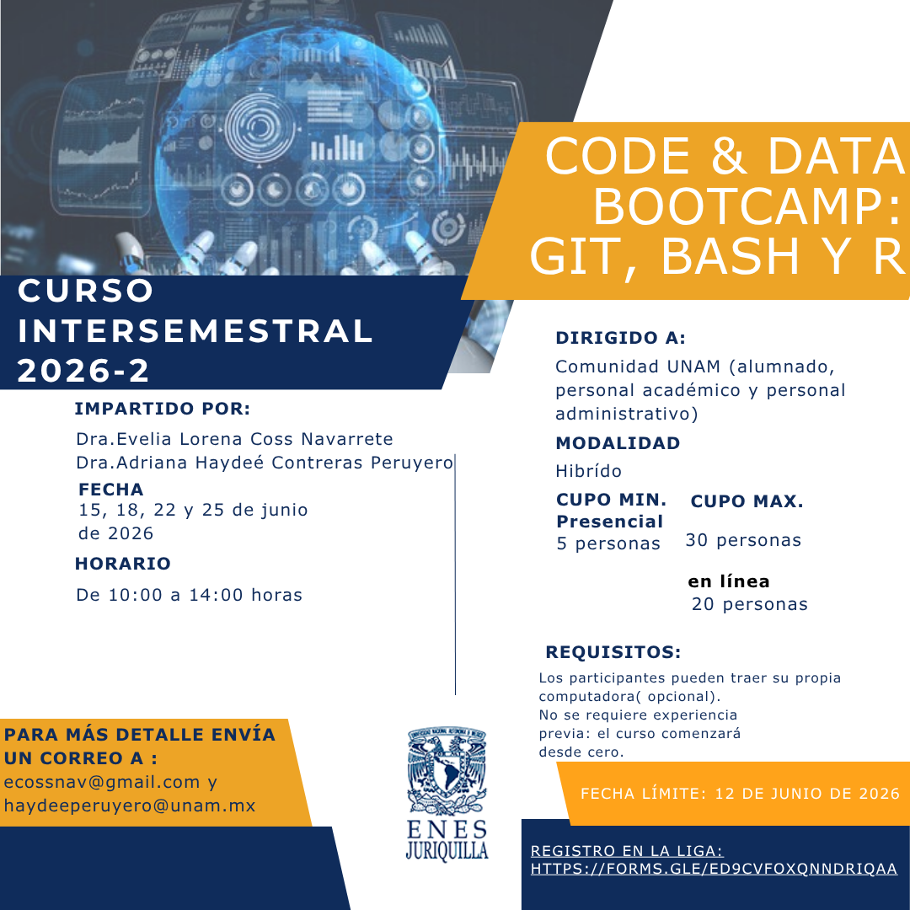


Code & Data Bootcamp: Git, Bash y R


Curso intensivo que ofrece una introducción práctica a tres herramientas fundamentales para la ciencia de datos y el desarrollo reproducible: **Git** para el control de versiones, **Bash** para automatizar tareas en la terminal y **R** para el análisis estadístico y la visualización. **No se requiere experiencia previa**: empieza desde cero y avanza paso a paso, combinando teoría y práctica.

## Datos del curso

- **Fechas:** 15, 18, 22 y 25 de junio de 2026 (lunes y jueves), de 10:00 a 14:00 h
- **Duración:** 16 horas (4 horas por día) · **Nivel:** básico · **Idioma:** español
- **Lugar:** ENES Juriquilla, UNAM · **Modalidad:** híbrida (30 lugares presenciales y 20 en línea)
- **Tipo:** curso intersemestral 2026-2, dirigido a la comunidad UNAM (alumnado, personal académico y administrativo)
- **Instructoras certificadas por The Carpentries:** Evelia Coss y Haydeé Peruyero (ENES Juriquilla). Curso registrado en The Carpentries.
- **Ayudantes, miembros de RSG-México:** Mayela Guadalupe Fosado Mendoza y Emilio Ortiz Avila (presenciales); Johanna Castelán Camarillo y Mariana Devon López (en línea)
- **Patrocinan:** ENES Juriquilla (UNAM) e ISCB Student Council, RSG-México

**¿Para quién?** Público general interesado en herramientas digitales, estudiantes y profesionales de cualquier disciplina, y personas interesadas en ciencia de datos o investigación reproducible que aún no han usado Git, Bash o R.

## Módulos

| Módulo | Tema |
|---|---|
| 1 | Preparación: instalación de Git, Bash, R y RStudio |
| 2 | Bash: la terminal desde cero |
| 3 | Git y GitHub |
| 4 | Introducción a R |
| 5 | Visualización de datos con ggplot2 |

## Material

<a class="presentacion-material" href="https://eveliacoss.github.io/Codedata_Bootcamp_Git_Bash_R2026_ENESJ/" target="_blank" rel="noopener">↗ Libro del curso</a>



El material se puede reutilizar citando la fuente, bajo la licencia [CC BY-NC-SA 4.0](https://creativecommons.org/licenses/by-nc-sa/4.0/).
