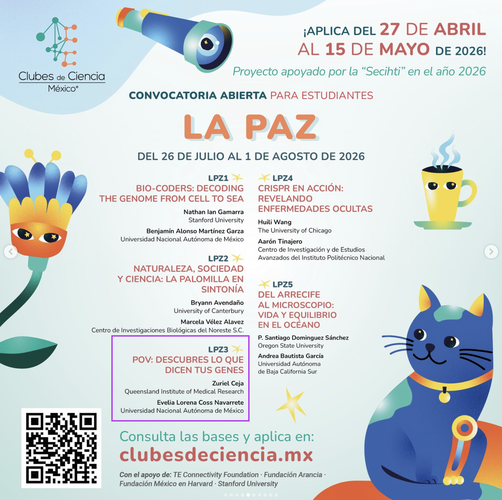


POV: Descubres lo que dicen tus genes 🧬


En este club explorarás cómo los genes interactúan con el entorno, el estrés, el sueño, los hábitos y la comunidad para influir en la salud y el bienestar. Con actividades prácticas, analizarás **datos reales en R** de forma accesible y guiada para descubrir patrones en genética, cerebro y salud mental. También habrá una **salida de campo** a los ecosistemas de La Paz para relacionar variables ambientales con los sistemas vivos. Al final, cada participante crea un **proyecto o póster** para contar una historia con datos, con su propio estilo.

## Datos del club

- **Edición:** Clubes de Ciencia México, verano 2026 (club **LPZ3**), proyecto apoyado por la Secihti
- **Sede:** La Paz, Baja California Sur
- **Fechas:** del 26 de julio al 1 de agosto de 2026; clases de lunes a viernes, de 9:00 a 17:00 h
- **Idioma:** español · **Nivel:** desde cero, no se requiere experiencia previa
- **Instructores:** Zuriel Ceja (QIMR Berghofer / The University of Queensland, Australia) y Evelia Coss (ENES Juriquilla, UNAM)
- **Ayudante:** José Manuel Echevarría Rubio (estudiante de doctorado, CIBNOR)
- **Organizadora:** Ana Patricia Ruiz Beltrán

## Agenda

| Día | Tema |
|---|---|
| 1 · lunes 27 de julio | Introducción: datos, genes y tú |
| 2 · martes 28 de julio | Descubre patrones en los datos |
| 3 · miércoles 29 de julio | Cerebro, conducta y ambiente (gen × entorno), con salida de campo |
| 4 · jueves 30 de julio | Caso de estudio: genes y el sistema inmune |
| 5 · viernes 31 de julio | Recta final del proyecto y presentación de pósters |

## Material

<a class="presentacion-material" href="https://eveliacoss.github.io/CdeCMx2026_Club_LPZ3_libro/" target="_blank" rel="noopener">↗ Libro del club</a> <a class="presentacion-material" href="https://docs.google.com/spreadsheets/d/1srJJY8kLpVImDrreTUftckYq1RMVIxNmKIXGqbsLa7A/edit?usp=sharing" target="_blank" rel="noopener">↗ Calendario del club</a>



El material se puede reutilizar citando la fuente, bajo la licencia [CC BY-NC-SA 4.0](https://creativecommons.org/licenses/by-nc-sa/4.0/).
