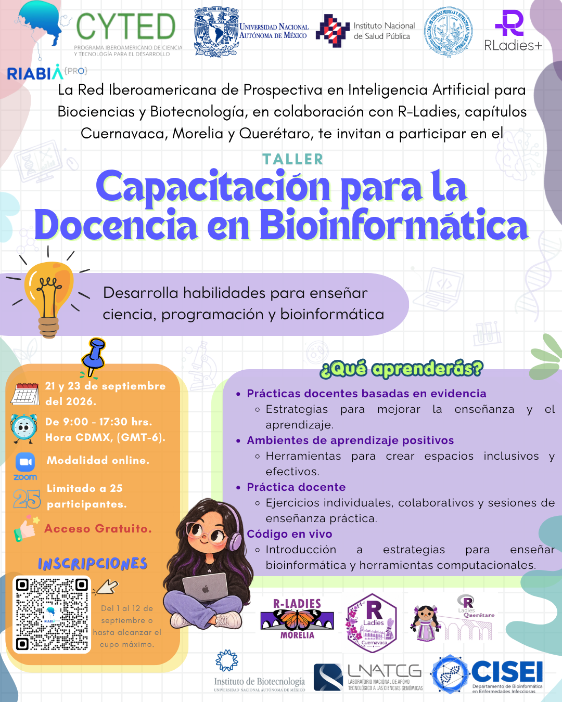


RIABIA + R-Ladies: Capacitación para la Docencia en Bioinformática


Taller para formar instructoras e instructores tipo **The Carpentries**. Gran parte del temario son principios educativos que sirven en cualquier contexto, así que también es para quien solo quiere mejorar su forma de enseñar.

🎯 **Objetivo:** elevar la calidad de los talleres y cursos impartidos por los miembros de RIABIA.

- Conocer las prácticas docentes basadas en evidencia.
- Crear un ambiente positivo y de aprendizaje en cualquier taller.
- Practicar y desarrollar habilidades de enseñanza.
- Introducción a la programación en vivo para enseñar bioinformática y herramientas computacionales.

## Datos del curso

- **Fechas:** lunes 21 y miércoles 23 de septiembre de 2026
- **Duración:** 16 horas (8 horas diarias), de 9:00 a 18:00 h (Ciudad de México)
- **Modalidad:** en línea por Zoom, **gratuito**, cupo limitado a 25 participantes
- **Organizan:** la Red Iberoamericana de Prospectiva en IA para Biociencias y Biotecnología (**RIABIA**, red CYTED) con R-Ladies **Cuernavaca**, **Morelia** y **Querétaro**
- **Instructoras certificadas por The Carpentries:** Verónica Jiménez Jacinto, Ernestina Godoy Lozano, Evelia Coss, Quetzally Medina Velázquez, Nelly Sélem Mojica y Sofía Zorrilla Azcué
- **Comité organizador:** además de las instructoras, Karla Leslie Matías Valdez (INSP, autora del flyer) y Mayra del Carmen Fragoso Medina (R-Ladies Morelia)

**Audiencia:** personas con experiencia enseñando programación, análisis bioinformáticos o ciencia de datos que quieren mejorar sus habilidades docentes, de preferencia en instituciones latinoamericanas.

**Qué no se ve:** cómo programar en R o Python, usar Git o SQL, crear lecciones desde cero ni hacer análisis bioinformáticos.

## Agenda

| Sección | Tema | Instructora |
|---|---|---|
| **Día 1 · lunes 21 de septiembre** | | |
| 1 | Bienvenida e introducción | Quetzally Medina |
| 2 | Modelos mentales y carga cognitiva | Ernestina Godoy |
| 3 | Memoria y otros principios | Verónica Jiménez |
| **Día 2 · miércoles 23 de septiembre** | | |
| 4 | Enseñar en línea y planificación de cursos | Evelia Coss |
| 5 | Audiencia y simulación de entrenamiento | Nelly Sélem |
| 6 | Programación en vivo y entrenamientos | Sofía Zorrilla |

Cada sección dura 2 h 30 min; cada día cierra con un cuestionario de evaluación.

## Material

<a class="presentacion-material" href="https://eveliacoss.github.io/RIABIA_RLadies_2026_Capacitacion_Docente/" target="_blank" rel="noopener">↗ Libro del curso</a> <a class="presentacion-material" href="https://docs.google.com/document/d/18cBrf20LvnqC8TXWCcJgz8unHtD2VN4UxXLGpF3yyzI/edit?usp=sharing" target="_blank" rel="noopener">↗ Documento colaborativo</a>



El curso usa materiales de [MetaDocencia y CABANAnet](https://www.metadocencia.org/curso/entrenamiento-instructores/), [The Carpentries](https://carpentries.github.io/instructor-training/) y [RStudio Education](https://education.rstudio.com/trainers/). El material se puede reutilizar citando la fuente, bajo la licencia [CC BY-NC-SA 4.0](https://creativecommons.org/licenses/by-nc-sa/4.0/).
