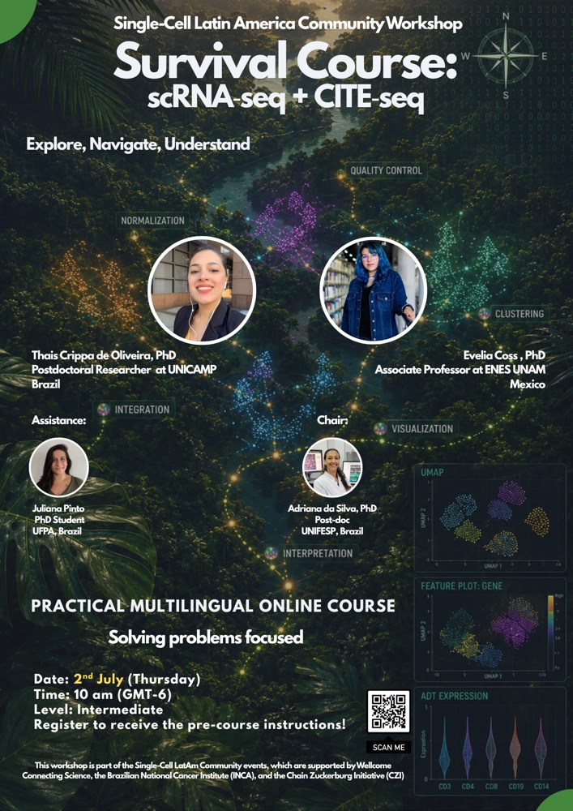


Survival Course: scRNA-seq + CITE-seq


🎯 **Objetivo:** que puedas navegar un conjunto de datos multimodal (RNA + ADT), hacer el preprocesamiento esencial e interpretar resultados básicos sin perderte en los detalles técnicos.

✅ **Al terminar tendrás:**
- Confianza para abrir y explorar datos multimodales.
- La capacidad de correr un pipeline básico de Seurat.
- Claridad sobre cómo los ADT (proteínas) complementan al RNA.
- Conciencia de las preguntas de investigación y las limitaciones de CITE-seq.

## Datos del curso

- **Dónde:** en línea, como parte del **Single-Cell Latin America Community Workshop**, los eventos de la [comunidad Single-Cell (SinCell) LATAM](https://wcscourses.github.io/Single_Cell_Community/) apoyados por Wellcome Connecting Science, el Instituto Nacional de Cáncer de Brasil (INCA) y la Chan Zuckerberg Initiative (CZI)
- **Costo:** gratuito
- **Idiomas:** impartido en 3 lenguas: 🇲🇽 español · 🇧🇷 portugués · 🇺🇸 inglés
- **Fecha:** jueves 2 de julio de 2026, 10:00 h en Ciudad de México 🇲🇽 · 13:00 h en Brasilia 🇧🇷
- **Duración:** 3 horas · **Nivel:** intermedio
- **Enfoque:** práctico, centrado en resolver problemas
- **Instructoras:** Dra. Thais Crippa de Oliveira 🇧🇷 (UNICAMP) y Dra. Evelia Coss 🇲🇽 (ENES Juriquilla, UNAM)
- **Chair:** Dra. Adriana da Silva 🇧🇷 (UNIFESP)
- **Asistencia:** Juliana Pinto 🇧🇷 (UFPA)

## Agenda

| Módulo | Tema | Duración | Instructora |
|---|---|---|---|
| 1 | Repaso: introducción a scRNA-seq + CITE-seq | 20 min | Evelia Coss |
| 2 | Configuración y uso de VirtualBox | 20 min | Thais Crippa |
| — | 🎮 Kahoot: introducción y configuración | 10 min | Ambas |
| 3 | Acerca del conjunto de datos (GSE149689) | 10 min | Evelia Coss |
| 4 | scRNA-seq: errores y supervivencia | 50 min | Thais Crippa |
| — | 🎮 Kahoot: bases de scRNA-seq | 10 min | Thais Crippa |
| 5 | CITE-seq: errores y supervivencia | 50 min | Evelia Coss |
| — | 🎮 Kahoot: bases de CITE-seq | 10 min | Evelia Coss |
| 6 | Extras opcionales para después de clase | — | — |

## Antes del curso

- Ten Git, R, RStudio y Bash instalados y funcionando.
- Instala los paquetes de R siguiendo [Prepárate para el taller](https://eveliacoss.github.io/Workshop2026_scRNAseq_CITEseq_libro/es/index.es.html).
- Una conexión a internet estable para sincronizar el repositorio y descargar paquetes.

## Material

<a class="presentacion-material" href="https://eveliacoss.github.io/Workshop2026_scRNAseq_CITEseq_libro/es/index.es.html" target="_blank" rel="noopener">↗ Libro del curso (español)</a> <a class="presentacion-material" href="https://eveliacoss.github.io/Workshop2026_scRNAseq_CITEseq_libro/" target="_blank" rel="noopener">↗ English</a> <a class="presentacion-material" href="https://eveliacoss.github.io/Workshop2026_scRNAseq_CITEseq_libro/pt/index.pt.html" target="_blank" rel="noopener">↗ Português</a>



El material se puede reutilizar y adaptar citando la fuente, bajo la licencia [CC BY-NC-SA 4.0](https://creativecommons.org/licenses/by-nc-sa/4.0/).
