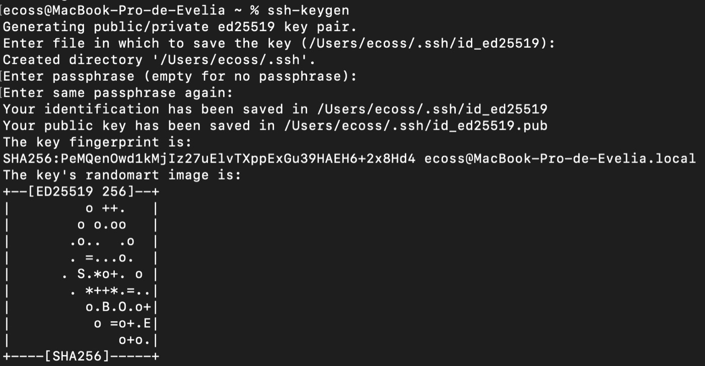
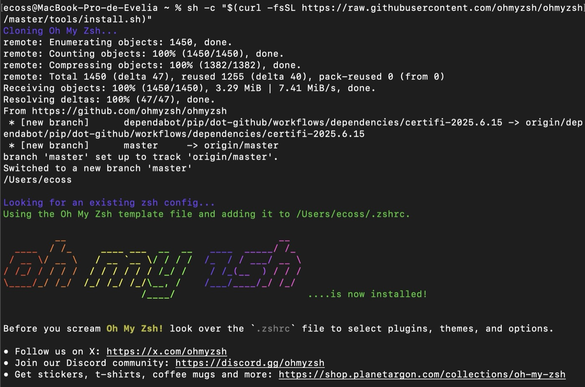
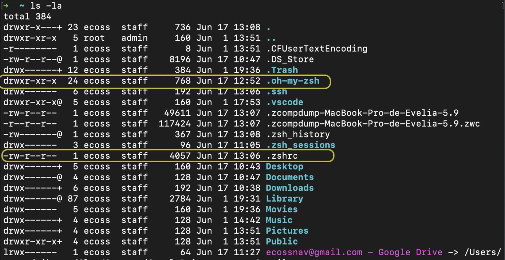

🎯 **Objetivo:** configurar llaves de acceso seguras (**llaves SSH**) para conectarte a servidores remotos o supercomputadoras **sin escribir tu contraseña en cada sesión**. Es más rápido y más seguro.

- **Autora:** Evelia Coss
- **Necesitas:** una terminal (Linux, Mac o Git Bash en Windows) y una cuenta en un servidor

En los ejemplos, cambia `usuario` por tu nombre de usuario y `ruta.servidor` por la dirección de tu servidor.

## Paso 1. Genera la llave en tu computadora

Abre una terminal y ejecuta `ssh-keygen`. Viene incluido en Mac, en Git Bash y en casi todas las distribuciones de Linux; si en Linux no lo tienes, instala el cliente de OpenSSH.

```bash
# Solo si no lo tienes (Linux, Debian/Ubuntu)
sudo apt-get install openssh-client

# Genera la llave (ed25519 es el tipo recomendado)
ssh-keygen -t ed25519
```

El programa te preguntará dónde guardar la llave y si quieres protegerla con una frase. Si no quieres complicarte, presiona **ENTER tres veces**. Verás algo así:



Se creará la carpeta `~/.ssh/` con dos archivos:

| Archivo | Qué es |
|---|---|
| `id_ed25519` | Tu **llave privada**. **Nunca la compartas.** |
| `id_ed25519.pub` | Tu **llave pública**. Esta es la que se copia a los servidores. |

## Paso 2. Copia tu llave pública al servidor

Revisa el contenido de tu llave pública:

```bash
cat ~/.ssh/id_ed25519.pub
```


**El camino corto:** si tu sistema tiene `ssh-copy-id`, este comando hace los pasos 2 y 3 de una vez:
`ssh-copy-id usuario@ruta.servidor`


Si no lo tienes, copia la llave a la carpeta `.ssh` de tu usuario en el servidor:

```bash
scp ~/.ssh/id_ed25519.pub usuario@ruta.servidor:/home/usuario/.ssh
```

## Paso 3. Agrega la llave a `authorized_keys` en el servidor

Entra al servidor (todavía te pedirá contraseña) y ve a la carpeta `.ssh` de tu HOME:

```bash
ssh usuario@ruta.servidor
cd ~/.ssh/
ls -la
```

Une tu llave pública con las llaves que ya existan en el archivo `authorized_keys`. Por buena práctica, primero se guarda el resultado en un archivo nuevo (`keys`) para no sobrescribir nada por error:

```bash
cat authorized_keys id_ed25519.pub > keys
```

Revisa que `keys` esté bien y entonces reemplaza `authorized_keys`:

```bash
mv keys authorized_keys
```


Si `authorized_keys` todavía no existe, basta con `cat id_ed25519.pub > authorized_keys`. SSH también exige permisos estrictos: `chmod 700 ~/.ssh` y `chmod 600 ~/.ssh/authorized_keys`.


## Paso 4. Entra al servidor sin contraseña

Sal del servidor (`exit`) y vuelve a entrar desde tu computadora:

```bash
ssh usuario@ruta.servidor
```

Si todo salió bien, ya no te pedirá la contraseña. 🎉

## Paso 5. Ubica tu archivo de configuración de la terminal

Para crear un atajo (alias), necesitas saber qué archivo de configuración usa tu terminal:

| Sistema | Archivo |
|---|---|
| Linux | `~/.bashrc` (ya existe) |
| Windows (Git Bash) | `~/.bashrc` (hay que crearlo) |
| Mac | `~/.zshrc` (o `~/.bash_profile` en versiones antiguas) |

**Linux:** el archivo ya existe; puedes verlo con `cat ~/.bashrc`.

**Windows (Git Bash):** crea el archivo con `nano ~/.bashrc`. Puede contener solo tus alias, por ejemplo `alias ll="ls -la"` para ver también los archivos ocultos.

**Mac:** desde macOS Catalina la terminal usa zsh. Si `~/.zshrc` no existe, créalo con `touch ~/.zshrc`. Otra opción es instalar [Oh My Zsh](https://ohmyz.sh/#install), que crea el archivo y agrega muchas configuraciones útiles:

```bash
sh -c "$(curl -fsSL https://raw.githubusercontent.com/ohmyzsh/ohmyzsh/master/tools/install.sh)"
```



Después verás en tu HOME la carpeta de configuración de Oh My Zsh y el archivo `.zshrc`:



## Paso 6. Crea un alias para entrar con una palabra

Abre tu archivo de configuración y agrega al final una línea como esta (aquí el alias se llama `unam`):

```bash
alias unam="ssh usuario@ruta.servidor"
```

**Linux y Windows:**

```bash
nano ~/.bashrc      # agrega el alias al final y guarda
source ~/.bashrc    # vuelve a cargar la configuración
```

**Mac:**

```bash
nano ~/.zshrc       # agrega el alias al final y guarda
source ~/.zshrc     # vuelve a cargar la configuración
```

## Paso 7. Prueba tu llave

Escribe tu alias en la terminal:

```bash
unam
```

Deberías entrar directo al servidor, sin contraseña.


## Material

<a class="presentacion-material" href="https://eveliacoss.github.io/keygen/Manual_Keygen.html" target="_blank" rel="noopener">↗ Manual original</a>


